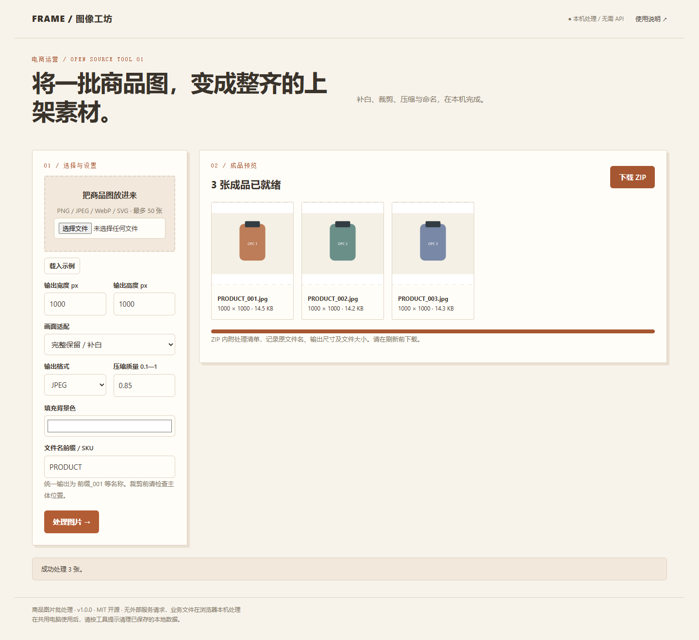

# 商品图片批处理

将一批商品图，变成整齐的上架素材。 补白、裁剪、压缩与命名，在本机完成。

## 快速使用

1. 下载仓库 ZIP 并解压。
2. 用 Chrome 或 Edge 打开项目根目录的 `index.html`。无需安装依赖、无需注册账号、无需配置 API。
3. 点击“载入示例”，再按界面操作。将示例替换成自己的文件或资料后导出。

## 使用流程

选择多张商品图 → 设置尺寸、背景与格式 → 处理图片 → 检查预览 → 下载 ZIP。

示例由程序在本地生成，无需下载图片。

## 功能与边界

- 支持补白、居中裁剪、格式转换、质量设置、统一命名、ZIP 和处理清单。
- 一次最多 50 张；单张原图最多 4000 万像素，输出最多 1600 万像素。大批量请分次处理。
- 不进行抠图、生成式扩图或平台合规认证。裁剪是否损失主体需人工确认。
- PNG 的 quality 参数不控制压缩率；JPEG 不保留透明通道，按背景色填充。
- 画面处理会重新编码，未保留原图 EXIF 等元数据。

## 数据与运行环境

- 所有业务处理在本机浏览器执行，无统计追踪、无远程字体、无 CDN 请求。
- 文件只保存在当前页面内存，关闭或刷新前请导出结果。
- 建议使用较新的桌面 Chrome / Edge。手机可查看界面，批量文件处理建议使用电脑。
- 发布到 GitHub Pages 后仍为静态本地处理工具。

## 开发

原生 HTML/CSS/JavaScript，无构建步骤。修改 `app.js`、`style.css` 后刷新页面。`utils.js` 提供文件下载、CSV 解析及安全输出等基础函数。

ZIP 功能使用本地打包的 JSZip（MIT），见 `THIRD_PARTY_NOTICES.md`。

## 发布

可将此文件夹的**内部文件**上传到一个独立 GitHub 仓库。根目录应直接包含 index.html、README.md 和 LICENSE。

## 许可与贡献

MIT，见 LICENSE。欢迎提交可复现的问题、示例和改进建议。许可证中的 Contributors 指向实际贡献者；发布者可根据真实权属补充署名。示例均为虚构资料，不包含真实客户数据。
